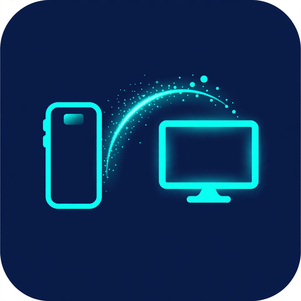

  

# 📡 Beamo Web

Browser-to-browser file sharing — no server, no internet, no account.

Two browsers on the same Wi-Fi (or hotspot) connect directly via **WebRTC DataChannel**. Signaling happens through **QR codes**, so the whole thing works fully offline.

## How to use

1. Open the page on both devices.
2. One side taps **Receive** → shows a QR code (connection offer).
3. Other side taps **Send** → **Scan QR** (or paste the code) → shows its answer QR/code back.
4. Receiver **scans the answer QR** (or pastes the code) → connected ✓
5. Sender picks files → receiver accepts → transfer with live progress, speed and ETA.

Text notes can be sent too — they arrive as copyable notes (with a save-as-.txt option).

Send files by drag & drop, folder picker, or tap the drop box to browse — you can also paste (Ctrl+V) copied files/screenshots straight into the Send screen. Larger files? No problem — files ≥ 150 MB stream straight to disk on both sides (no RAM limit), so multi-GB transfers work. Turn on **Auto-accept** on the receiver to skip the accept tap for every file.

If the connection drops mid-transfer, reconnect and the same file is re-offered automatically — the receiver reports how much it already has and the transfer **resumes** where it stopped instead of starting over. (Both pages need to stay open.)

## Notes

- QR scanning uses the browser's built-in `BarcodeDetector` (Chrome/Edge on Android). If unavailable, paste the code instead. Signaling codes are deflate-compressed, so the QR is smaller and scans faster.
- QR-both-ways needs a camera on both sides (phone ↔ phone, phone ↔ laptop). A camera-less TV can't scan — for TV transfers, use the Beamo app's browser-upload page.
- Files are transferred peer-to-peer and never touch a server.
- Large files (≥ 150 MB): the receiver picks a save location up front (File System Access API, Chrome) or the transfer goes to an app-private disk file (OPFS) — the browser's RAM never fills up.

## Notes

- QR scanning uses the browser's built-in `BarcodeDetector` (Chrome/Edge on Android). If unavailable, paste the code instead.
- QR-both-ways needs a camera on both sides (phone ↔ phone, phone ↔ laptop). A camera-less TV can't scan — for TV transfers, use the Beamo app's browser-upload page.
- Files are transferred peer-to-peer and never touch a server.

## Files

- `index.html` — the page
- `logo.png` — Beamo logo
- `style.css` — dark Beamo theme
- `app.js` — WebRTC handshake + transfer protocol (no dependencies)
- `qrcode.min.js` — inlined QR generator ([qrcode-generator](https://github.com/kazuhikoarase/qrcode-generator), MIT)

Host it anywhere static — GitHub Pages, Netlify, or just open `index.html` on each device.
